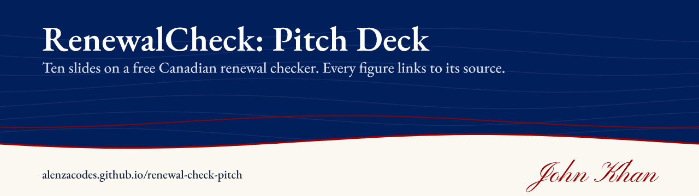
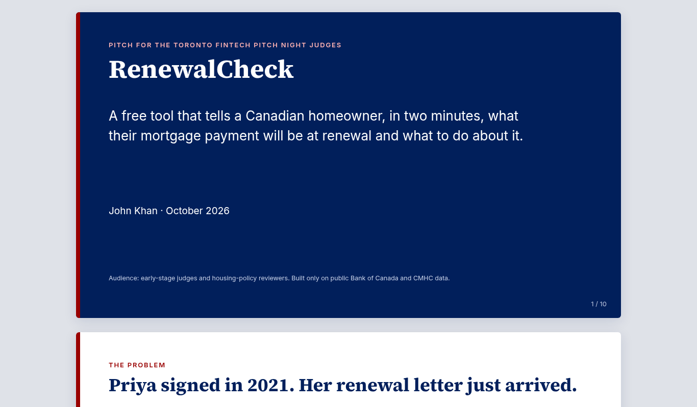
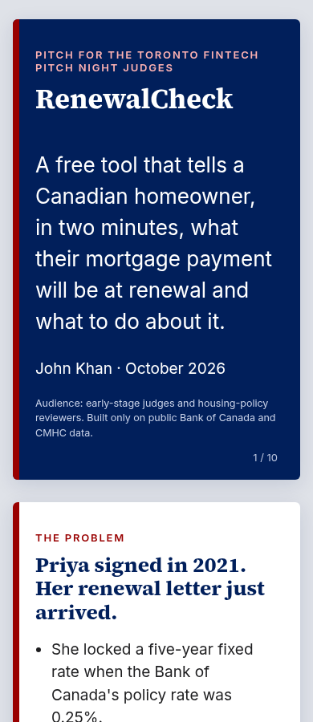

# RenewalCheck: Pitch Deck

**Ten-slide pitch for RenewalCheck, a free Canadian mortgage renewal checker. Every figure links to a Bank of Canada or CMHC source.**

   

**Live:** https://alenzacodes.github.io/renewal-check-pitch/

A ten-slide pitch for RenewalCheck, a free tool that tells a Canadian homeowner, in two minutes, what their mortgage payment will be at renewal and what to do about it. The working tool is at https://alenzacodes.github.io/renewal-check/ and its code is in [renewal-check](https://github.com/ALENZACODES/renewal-check).

## What it does

1. RenewalCheck
2. The problem: one homeowner who signed in 2021 opens her renewal letter
3. Why now: the low rates of 2020 to 2022 are gone and those mortgages are coming due
4. The product: enter four numbers and see your renewal plainly
5. Market: how many households renew, from public data only
6. Alternatives and their catch
7. Model: free for homeowners, funded like a public good
8. The next 90 days
9. Why I'm building this
10. The ask

## Checked figures

- Payment illustration: $500,000 at 4.79% over 25 years is $2,849 a month with semi-annual compounding. After five years the balance is $441,063, and at 6.19% over the remaining 20 years the payment is $3,188, up $340.
- Rates: Bank of Canada series V80691335 was 4.79% in November 2021 and 6.19% in October 2026. Series V39079 was 0.25% in 2021 and is 2.25% now, nine times higher.
- Mortgage debt: CMHC's Spring 2026 Residential Mortgage Industry Report puts residential mortgage debt above $2.4 trillion in December 2025.

## Quick start

It is a single HTML page with no build step. Open the live link, or open `index.html` in a browser, or serve the folder with `python3 -m http.server 8000` and open http://localhost:8000/. Each slide is a 16:9 panel, so printing to PDF from the browser gives one slide per page. On a phone the slides stack and the text reflows:

## Tests

Needs Node 20 or later. No dependencies.

    node --test

Five checks: ten numbered slides, a heading on each, https on every link, every source listed below linked in the deck, and the author tag. They run on every push through GitHub Actions.

## Data and sources

Every figure on the slides links to its source:

- Bank of Canada, policy interest rate: https://www.bankofcanada.ca/core-functions/monetary-policy/key-interest-rate/
- Bank of Canada, posted rates offered by chartered banks: https://www.bankofcanada.ca/rates/banking-and-financial-statistics/posted-interest-rates-offered-by-chartered-banks/
- Bank of Canada Valet API: https://www.bankofcanada.ca/valet/docs
- CMHC, Residential Mortgage Industry Report: https://www.cmhc-schl.gc.ca/professionals/housing-markets-data-and-research/housing-research/research-reports/housing-finance/residential-mortgage-industry-report

## Licence

MIT. Copyright 2026 John Khan.

---

More of my work is on my [GitHub profile](https://github.com/ALENZACODES).
